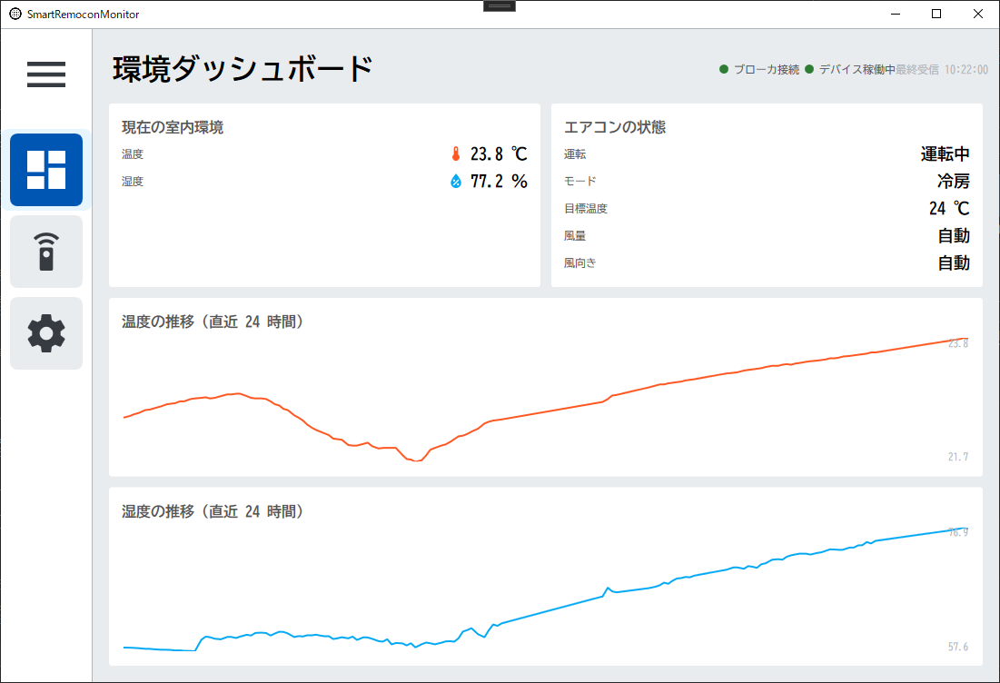
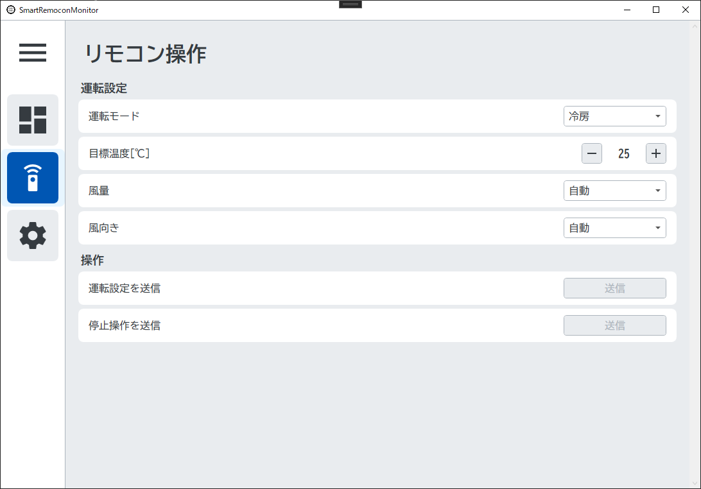
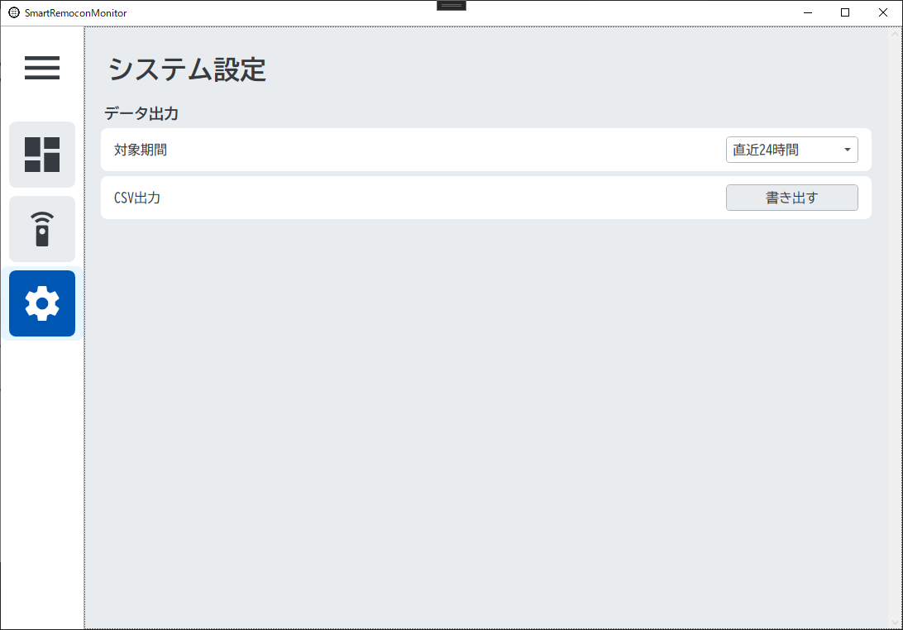
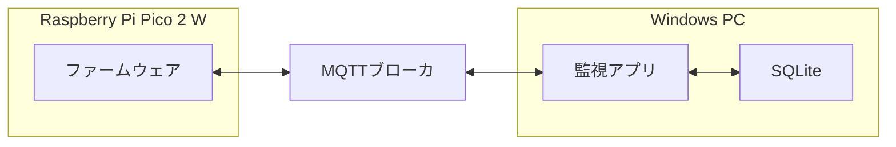

# エアコン自動制御装置の制御アプリ

エアコン自動制御装置（マイコン）を MQTT経由で監視・操作するPCアプリ

---

## 画面

| ダッシュボード | リモコン操作 | システム設定 |
|---|---|---|
|  |  |  |
| 室内環境・エアコン状態・グラフ | エアコンを操作 | システム設定 |

---

## システム構成



---

## 主な機能

|機能|詳細|
|---|---|
|**常時監視**|温湿度を受信して表示する。マイコンやMQTTブローカの状態をランプで表示する。
|**グラフ表示**|直近24時間の温湿度を折れ線グラフで描画。
|**遠隔操作**|エアコンを操作する。
|**CSV出力**|温湿度の生データを出力。

---

## 開発環境

| 分類 | 詳細 |
|---|---|
| ランタイム | .NET 10 (`net10.0-windows`, x64) |
| MVVM | CommunityToolkit.Mvvm 8.4.2 |
| DI | Microsoft.Extensions.Hosting 10.0.12（Generic Host） |
| 通信 | MQTTnet 5.2.0.1603（MQTT 3.1.1） |
| DB | Microsoft.Data.Sqlite 10.0.12 |
| ログ | NLog.Extensions.Logging 6.2.0 |
| アイコン | MahApps.Metro.IconPacks.Material 6.2.1 |
| テスト | xUnit 2.9.3 |

---

## MQTT インターフェース

| トピック | 向き | QoS | retain | 内容 |
|---|---|:---:|:---:|---|
| `ac/sensor` | マイコン → PC | 0 | × | 温度・湿度の定期送信 |
| `ac/state` | マイコン → PC | 1 | ○ | デバイスが最後に送った赤外線の内容 |
| `ac/state/set` | PC → マイコン | 1 | × | 運転操作 |
| `ac/status` | マイコン → PC | 1 | ○ | `online` / `offline` |

### ペイロード例

```jsonc
// ac/sensor （マイコン → PC）
{ "temp": 26.40, "hum": 58.10 }

// ac/state （マイコン → PC）
{ "power": true, "mode": "cooling", "target": 26, "fan": "2", "airflow": "auto" }

// ac/state/set （PC → マイコン）
{ "power": true, "mode": "cooling", "target": 26, "fan": "2", "airflow": "auto" }
{ "power": false }
```
---

## プロジェクト構成

```
SmartRemoconMonitor/
├── App.xaml.cs                  エントリポイント
├── Configuration/               設定クラスと検証、保存先パスの解決
├── Converters/                  XAML用の値変換
├── Models/                      表示用の値など
├── Services/
│   ├── Mqtt/                    MQTT関連
│   ├── Storage/                 DB関連
│   ├── Export/                  CSV関連
│   ├── Settings/                ユーザー設定関連
│   ├── Navigation/              画面遷移
│   └── Ui/                      UIスレッド・ファイルダイアログの抽象化
├── ViewModels/                  画面ロジック
└── Views/                       XAML
```

